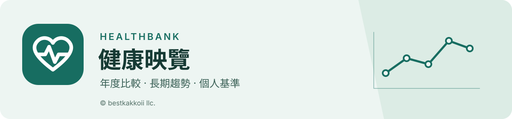
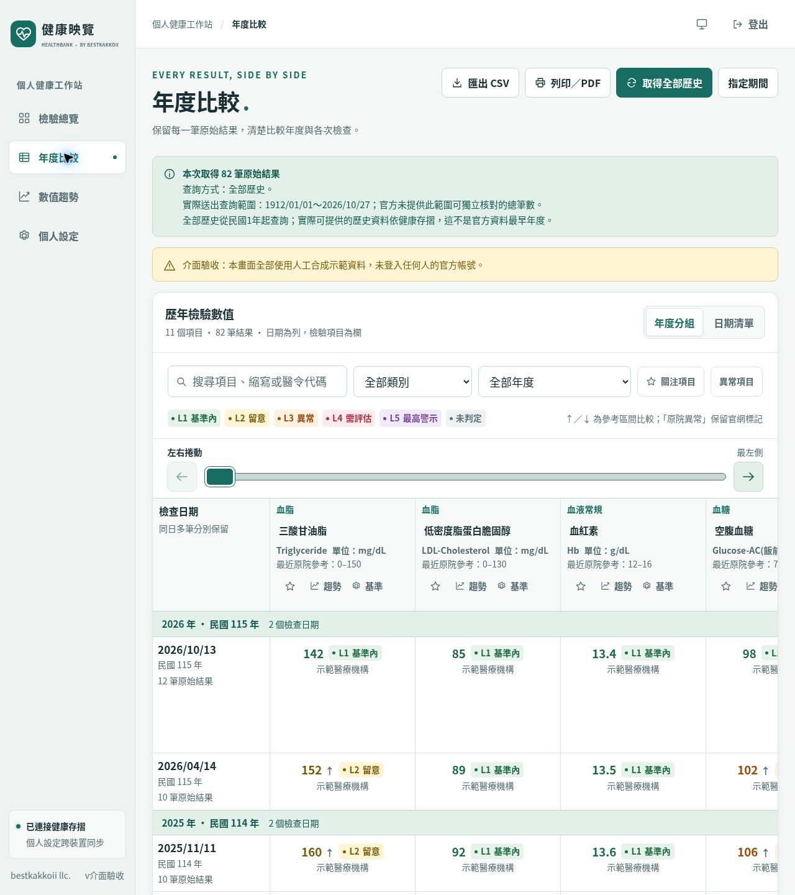

# 健康映覽 · Healthbank

**把健康存摺逐筆列出的檢驗資料，整理成易讀、可比較、可追溯的年度表格與趨勢。**

[下載與發行](https://github.com/bestkakkoii/healthbank/releases) · [部署](docs/deployment.zh-TW.md) · [資料處理](docs/privacy.zh-TW.md) · [驗證](docs/verification.zh-TW.md) · [實機驗收](docs/acceptance.zh-TW.md)

獨立 MIT 開源專案，非健保署官方服務。Go 執行檔內嵌 React 前端；SQLite 預設、MySQL 選用。
不要求特定主機面板、額外會員帳號或日常打卡。前端不載入外部腳本、字型或廣告分析服務。

## 功能

| 功能 | 邊界 |
| --- | --- |
| 全歷史查詢 | 明確送出日期範圍、保留來源及同日多筆；官方實際留存範圍仍適用，不把收到陣列當作終身完整證明 |
| 年度比較 | 日期為列、項目為欄；搜尋、收藏、年度篩選及可見橫向控制 |
| 趨勢 | 修正同日多筆造成的前段斷線；真實日期／檢查日期等距可切換，保留每筆精確數值與原始明細，區間或不等式不偽造單點 |
| 年齡／性別情境 | 本人與比較條件並列、即時生效；提供九項來源具名範本（實際年齡／性別分層依來源而定），符合條件後可估算CKD-EPI 2021；不覆寫原院數據 |
| 個人基準 | 未匯入也顯示內建項目，支援個別／全部還原；官方驗證後跨裝置同步 |
| 登入記憶 | 私人裝置自選記住多位使用者的證號／卡號；密碼由瀏覽器管理，驗證碼由本人輸入 |
| 匯入與輸出 | HTML／ZIP及本站版本化 JSON／XML 可攜報表匯入；CSV、JSON（明確 UTF-8，選配 BOM）、XML、SVG及列印匯出。不是健保署任意同名格式的通用匯入器 |
| 補充資料 | 官方驗證後可按需讀取用藥、慢連箋、西／中／牙醫就醫、手術、住院等清單／明細，及原有健檢類別；僅依公開網頁契約與合成測試，未經真實帳號驗收 |
| 藥品時間圖／個人品項 | 同官方藥品代碼彙整歷次處方給藥日數、保留每筆原文及日期；不推定實際服藥、劑量或斷藥。另有選配裝置端西藥、中藥、補充品紀錄，不上傳伺服器 |
| 輔助分析 | 多指標同日期軸、前後差值；高 TG 下先保留院所原始 LDL，Friedewald 不適用時明示；僅於研究適用範圍內選配 Sampson 估算及同次 non-HDL |

淺色／深色／跟隨系統，支援應用字級放大。手機不固定日期欄，桌面保留固定日期。
實體iOS、密碼管理員、真實官方資料完整性與實際部署各自驗收，不用模擬測試替代。

## 部署

下載符合CPU架構的Linux發行包，解壓並執行 `healthbank`；對外由HTTPS反向代理轉送。
預設監聽 `127.0.0.1:8787`，在執行檔旁建立 `data/`。不用安裝Go、Node.js、Python、Chromium或SQLite服務。
部署方式、系統服務與代理配置見[部署文件](docs/deployment.zh-TW.md)。

| 範圍 | 支援與查核 |
| --- | --- |
| 主要目標 | Debian 13（trixie）x86_64；Linux amd64靜態執行檔 |
| 其他架構 | Linux arm64交叉編譯；原生機器驗收另列 |
| 瀏覽器 | 持續更新的Chrome、Edge、Firefox、Safari；需要JavaScript與短效工作階段Cookie |
| 行動裝置 | 以iOS Safari為重點；原生縮放、密碼自動填入、鍵盤與橫直向須實機驗收 |
| 網路與作業系統 | 有效CA信任、正確時間、DNS及對外HTTPS；部署平台不限定面板 |
| 開發 | 工具來源、版本、提交及相容性限制集中在鎖定檔與[依賴文件](DEPENDENCIES.md) |

尚未建立通用最低瀏覽器版號或硬體下限，不杜撰可用範圍。預覽版在Releases明確標示；Latest不一定指向預覽版。

## 資料保存

- **SQL只保存假名化識別碼與設定**，不保存原始證號、卡號、密碼、官方權杖或檢驗結果。假名化不等於匿名，設定仍需保護。
- **官方工作階段與報告只在記憶體**。API回應不快取；代理、CDN、交換空間、轉存及備份須由實際營運者另行稽核。
- **裝置記憶由使用者選擇**，可忘記單人或全部。密碼不寫入網站儲存；密碼管理員可能要求生物辨識並依其設定同步。
- **比較情境由本人自行選擇保存為同步設定**；生日與實際健康數值只留在本次使用頁面，不會同步。使用者主動匯出的檔案由本人管理。

更新前停止服務，保留並備份 `data/`，尤其 `identity.key` 與設定資料庫須一起保留。
登入逾時、登出或服務重啟後需重新取得報告。詳見[隱私與資料處理](docs/privacy.zh-TW.md)。

## 開發與狀態

Agent從[README_AI.md](README_AI.md)開始；建置與嚴格檢查見[CONTRIBUTING.md](CONTRIBUTING.md)。

[原始判讀規則](docs/clinical-reference.zh-TW.md) · [情境計算契約](docs/comparison-engine.md) · [官方協定](docs/nhi_protocol.md) · [變更紀錄](CHANGELOG.md) · [第三方授權](THIRD_PARTY_NOTICES.md)

已接入的額外官方資料讀取均依公開網頁協定實作與合成契約測試，尚未在真實授權帳號驗收；官方協定變動時會明確回報錯誤。實體裝置、營運者法遵告知、CDN／主機不落地稽核，仍須在實際部署環境個別驗收，不得視為軟體已認證。

原始碼採[MIT License](LICENSE)。使用者資料、官方文件與第三方元件不因此改變其權利。

Copyright © 2026 **bestkakkoii llc.**
